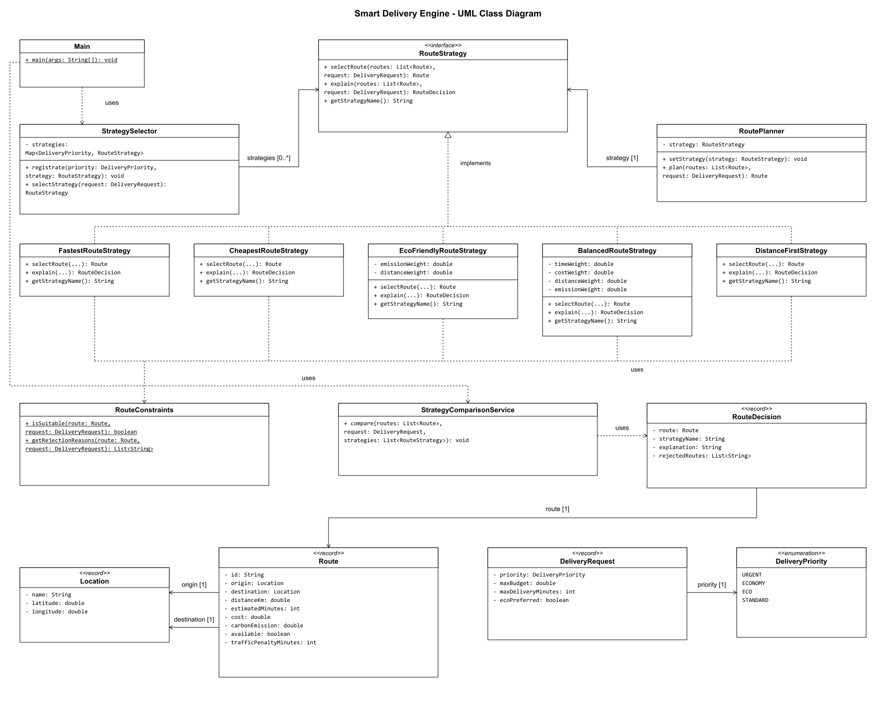
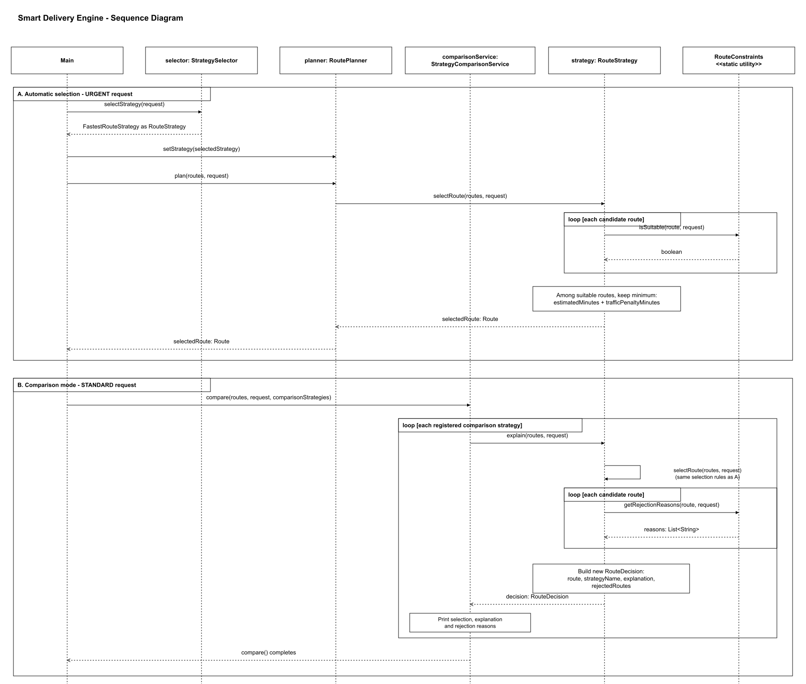

# Assignment 5 - Smart Delivery & Route Optimization Engine

## Architecture Description

My project uses the Strategy pattern to choose delivery routes in different ways.

`RoutePlanner` is the Context. It stores the selected strategy and calls its selectRoute() method. The setStrategy() method allows the program to change the strategy while it is running.

`RouteStrategy ` is the common interface. Five classes implement it: FastestRouteStrategy, CheapestRouteStrategy, EcoFriendlyRouteStrategy, BalancedRouteStrategy, and DistanceFirstStrategy. Each class has its own rules for choosing a route.

`StrategySelector` chooses a strategy based on the delivery priority. For example, an urgent delivery uses the fastest strategy.

`RouteConstraints` checks route availability, budget, and delivery time. All strategies use these checks before choosing a route.

`Location`, `Route`, and `DeliveryRequest` store the delivery data. RouteDecision stores the selected route and explains the result.

`Main` creates the objects and shows how the program works. StrategyComparisonService runs all strategies with the same request and prints their results.

## Example console output

This is a short example of the program output. Different delivery priorities can lead to different routes.

```
Automatic strategy = Balanced Route Strategy
Automatic route = R4

URGENT -> R2
ECONOMY -> R3
ECO -> R4
```

The program also explains why a route was selected. For example, the Balanced strategy shows its calculations:

```
Balanced Route Strategy
Selected: R4
Normalized time: 0.9 * 0.4
Normalized cost: 0.5084745762711864 * 0.3
Normalized distance: 0.375 * 0.1
Normalized emission: 0.08333333333333333 * 0.2
Final score: 0.5667090395480227
Lowest weighted score among suitable routes.
R6: Route is unavailable
```

When something goes wrong, the program shows an error message:

```
FAILURE SCENARIOS
Empty list: No route satisfies the delivery constraints
Invalid weights: Weights must add up to 1
No valid route: No route satisfies the delivery constraints
```

## QUESTIONS

**1.What problem does Strategy solve in this project?**

The project needs different ways to choose a delivery route. Strategy puts each algorithm in a separate class and allows the program to change the algorithm during execution.

**2.Where is the Context?**

The Context is RoutePlanner in the service package. It stores the selected strategy and calls its selectRoute() method.

**3.Where is the Strategy interface?**

The interface is RouteStrategy in the strategy package. It contains three methods: selectRoute(), explain(), and getStrategyName().

**4.What are the Concrete Strategies?**

They are FastestRouteStrategy, CheapestRouteStrategy, EcoFriendlyRouteStrategy, BalancedRouteStrategy, and DistanceFirstStrategy.

**5.Where is runtime strategy switching demonstrated?**

It is demonstrated in Main. The same RoutePlanner changes from Fastest to Cheapest, then to EcoFriendly and Balanced using setStrategy().

**6.Why is this Strategy rather than simple if/else?**

Each algorithm has its own class, and all strategies implement the same interface. RoutePlanner calls the selected strategy through this interface. It does not need conditions to choose which algorithm to run.

**7.How can a new Strategy be added?**

I can create a new class that implements RouteStrategy and write its selection and explanation methods. Then I can pass it to the planner and add it to the comparison list. I do not need to change RoutePlanner.

**8.What is the difference between Strategy and Bridge in the context of your previous assignment?**

Strategy allows an object to use different algorithms for the same task. Bridge separates an abstraction from its implementation, so both parts can change independently. Here, I use Strategy because I need different algorithms for choosing a route.

**9.Which SOLID principles are demonstrated?**

**SRP:** Different classes have different responsibilities. For example, StrategySelector chooses a strategy, and RouteConstraints checks restrictions.

**OCP:** I added DistanceFirstStrategy without changing the planner or the other strategies.

**DIP:** RoutePlanner depends on the RouteStrategy interface. The concrete strategy is passed to it through the constructor or setter.

**10.What limitation does your current architecture have?**

The program only selects from a prepared list of routes. It does not build new routes or receive live traffic information. Also, automatic strategy selection currently uses only the delivery priority.

## UML Diagrams

**UML Class Diagram**



**UML Sequence Diagram**



## Test Results

I created 15 automated tests using JUnit 5. They check all five strategies, runtime switching, automatic strategy selection, route constraints, comparison mode, and error handling.

All 15 tests passed. The tests also check boundary cases. For example, a route is accepted when its cost is exactly equal to the budget. Invalid Balanced weights and an empty route list cause the expected exceptions.